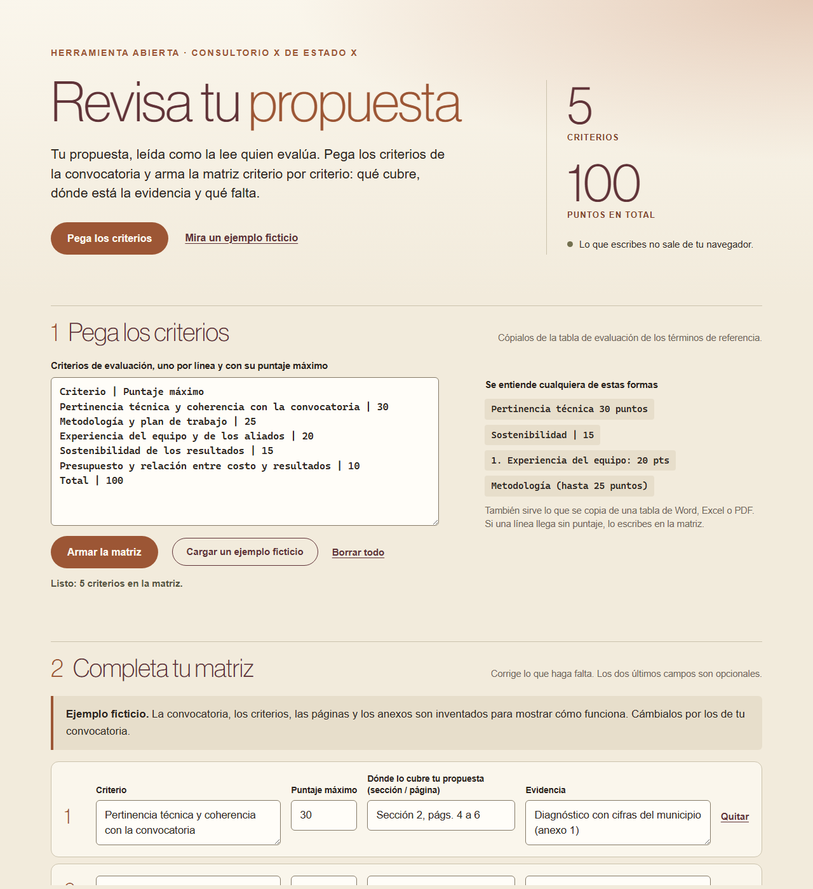

# Revisa tu propuesta · Colombia

[Español](#español) · [English](#english)



## Español

Una herramienta gratis y abierta para leer tu propuesta como la lee quien evalúa, antes de enviarla a una convocatoria: pegas los criterios de los términos de referencia y arma la matriz criterio por criterio. Es para equipos de cooperación, ONG, fundaciones, universidades y proyectos que postulan a convocatorias.

**Ábrelo aquí:** https://estado-x.github.io/revisa-tu-propuesta-colombia/

### Qué hace

- Lee los criterios que pegas (una línea por criterio, con su puntaje máximo) y los deja como filas que puedes corregir. Suma los puntajes y avisa si no cuadran con el total que traían los términos.
- En cada criterio puedes anotar dónde lo cubre tu propuesta (sección y página) y con qué evidencia.
- Arma un texto para llevar a Claude, ChatGPT, Gemini o Copilot. Le pide leer la propuesta como quien evalúa: puntaje provisional con justificación y cita de sección y página, evidencia que falta, afirmaciones sin respaldo y requisitos habilitantes que no aparecen. Le pide, además, no reescribir la propuesta ni inventar contenido.
- Descarga la matriz en Excel (.xlsx) con estas columnas: Criterio · Puntaje máximo · Dónde lo cubre (sección/página) · Evidencia · Qué falta · Puntaje estimado · Lo que vas a cambiar.
- Trae una lista corta, «Antes de enviar», con los requisitos habilitantes que más se olvidan: formatos, firmas, anexos, límite de páginas, tamaño de archivos, hora de cierre y canal de envío.

### Cómo funciona

Es una página estática: HTML, CSS y JavaScript sin dependencias. Todo corre en tu navegador; no hay servidor, cuentas, claves ni rastreadores, y la página no guarda ni envía lo que escribes. Al cerrar la pestaña se borra.

- `assets/criterios.js` lee los criterios (acepta `Pertinencia técnica 30 puntos`, `Sostenibilidad | 15`, `1. Experiencia: 20 pts`, tablas copiadas de Word, Excel o PDF), suma y arma el texto para la IA.
- `assets/excel.js` y `assets/zip.js` escriben el .xlsx sin librerías. Vienen de [facturas-colombia](https://github.com/Estado-X/facturas-colombia), de Estado X (MIT).
- `assets/app.js` maneja la página. El texto que escribes nunca se inserta como HTML.

La página no lee tu propuesta: la lectura la hace la IA que tú elijas, en tu propia cuenta y con sus condiciones de uso.

### Úsalo o adáptalo

1. Copia el repo (**Fork** o **Use this template**) o descárgalo. La rama es `main`.
2. Abre `index.html` en el navegador: funciona sin instalar nada.
3. Para adaptarlo a tu organización, cambia el texto para la IA en `assets/criterios.js` (función `armarPrompt`), la lista «Antes de enviar» (`ANTES_DE_ENVIAR`) y el ejemplo (`EJEMPLO`).
4. Para publicarlo, activa GitHub Pages (Settings → Pages → rama `main`, carpeta raíz) y cambia en `index.html` las direcciones que llevan a este repo por las de tu copia.

Pruebas (Python 3.10 o más reciente):

```
pip install playwright openpyxl
python -m playwright install chromium
python pruebas/probar.py
```

### Límites

- No escribe ni reescribe la propuesta, no garantiza un puntaje y no conoce los criterios ocultos de quien evalúa.
- El puntaje que estima una IA es una pista, no un veredicto. Una IA puede equivocarse al citar una página: revisa cada cita contra tu documento.
- La lista «Antes de enviar» es general. Los requisitos que valen son los de los términos de referencia de tu convocatoria.
- Si tu propuesta tiene datos sensibles (nombres, cédulas, salarios, datos de beneficiarios), tápalos antes de pegarla en una IA: https://estado-x.github.io/tapa-tus-datos-colombia/
- Tú decides qué cambiar. La matriz solo señala.

### Crédito

- Inspirado en [ai-for-grant-writing](https://github.com/eseckel/ai-for-grant-writing), de Elizabeth Seckel (licencia CC BY 4.0); no reutiliza su contenido.
- El escritor de Excel viene de [facturas-colombia](https://github.com/Estado-X/facturas-colombia), de Estado X (licencia MIT).

### Hecho por Estado X

Licencia MIT. Esta herramienta es una muestra de lo que montamos en Consultorio X de Estado X para el ciclo completo de una convocatoria. Para hablar de tu caso, escríbele a Juan Camilo Pérez Cuervo en LinkedIn: https://www.linkedin.com/in/juanperezcuervo/

## English

A free, open tool to read your proposal the way a reviewer will, before you submit it to a call for proposals: paste the evaluation criteria from the terms of reference and it builds the matrix, criterion by criterion. Built for cooperation teams, NGOs, foundations, universities and projects in Colombia. The interface is in Spanish.

**Open it here:** https://estado-x.github.io/revisa-tu-propuesta-colombia/

- **What it does:** parses the criteria you paste (one per line, with its maximum score), shows them as editable rows with the total, and lets you note where your proposal covers each one and with what evidence. It builds a prompt for Claude, ChatGPT, Gemini or Copilot that asks for a reviewer-style reading (provisional score with justification and section/page citations, missing evidence, unsupported claims, missing eligibility requirements) and explicitly forbids rewriting the proposal or inventing content. It exports the matrix as a real .xlsx file and includes a short pre-submission checklist.
- **How it works:** a static page (HTML, CSS and dependency-free JavaScript). Everything runs in your browser: no server, accounts, API keys or trackers, and nothing you type is stored or sent. The page never reads your proposal; the AI assistant you choose does, under its own terms.
- **Use or adapt it:** fork it or download it (branch `main`) and open `index.html`. Edit the prompt, the checklist and the example in `assets/criterios.js`. Tests: `python pruebas/probar.py` (Playwright and openpyxl).
- **Limits:** it doesn't write the proposal, guarantee a score or know a reviewer's unwritten criteria. An AI's estimated score is a hint, not a verdict, and its page citations must be checked. Redact sensitive data before pasting a proposal into an AI: https://estado-x.github.io/tapa-tus-datos-colombia/
- **Credit:** inspired by [ai-for-grant-writing](https://github.com/eseckel/ai-for-grant-writing) by Elizabeth Seckel (CC BY 4.0); it doesn't reuse its content. The Excel writer comes from [facturas-colombia](https://github.com/Estado-X/facturas-colombia) by Estado X (MIT).

Made by Estado X · MIT license.
